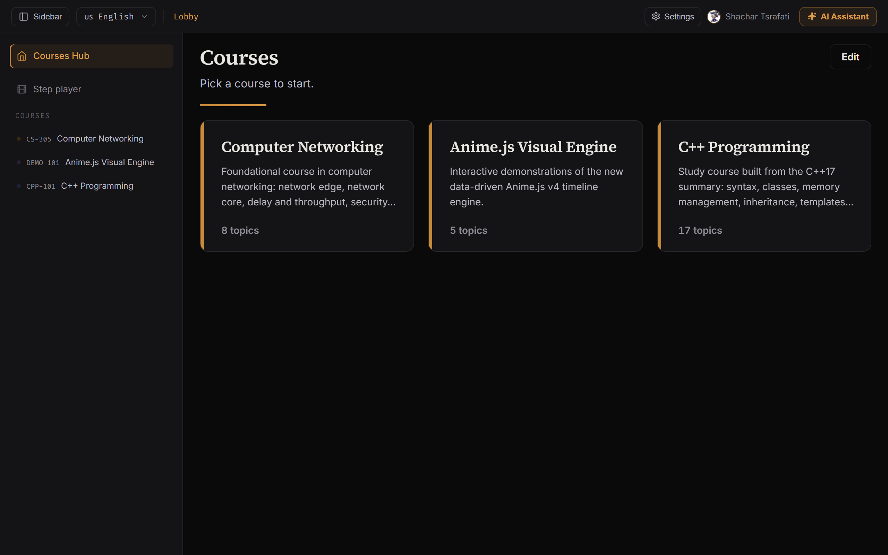
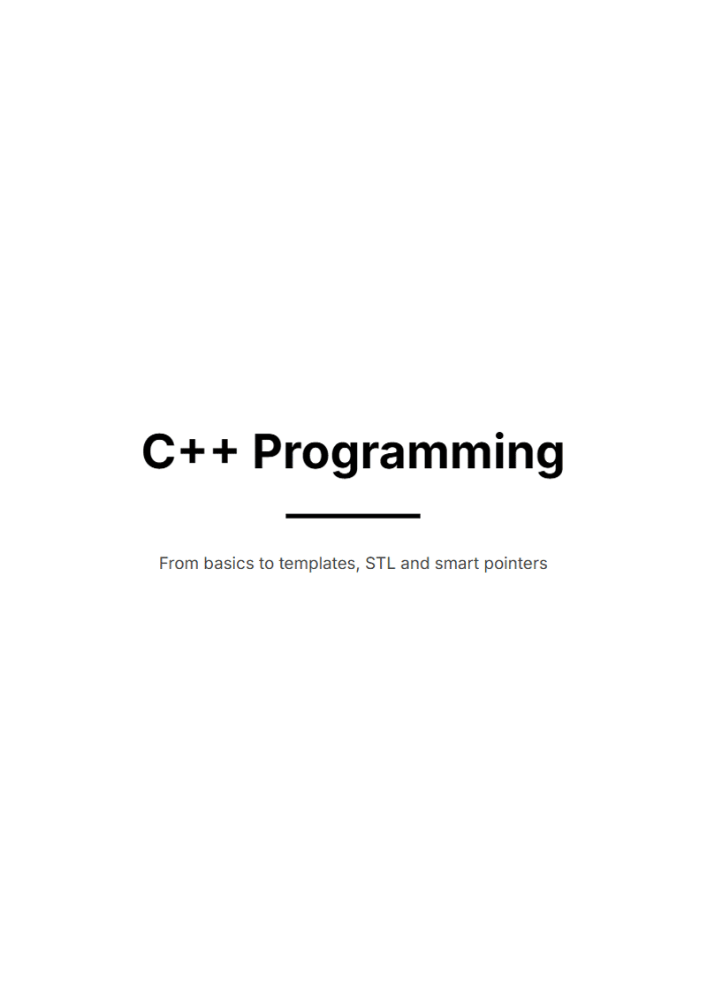
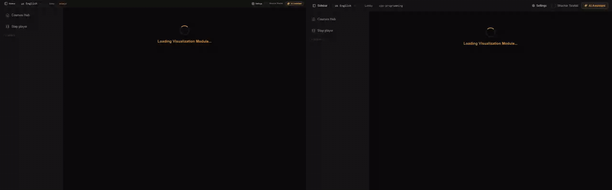

<p align="center">
  
</p>

<h3 align="center">Local-first study platform for computer science: canvas lessons, step animations, and an MCP server for AI tools.</h3>

<p align="center">
  <a href="https://nodejs.org"></a>
  <a href="https://react.dev"></a>
  <a href="https://modelcontextprotocol.io"></a>
  <a href="LICENSE"></a>
</p>

<p align="center">
  
</p>

## What it is

StudyTs runs on your computer. A course is split into weeks and topics. Each topic is a canvas page you can read and edit. Some lectures are step animations. The app also runs an MCP server, so AI tools can create and edit courses directly. Your courses, notes, and database stay in local files.

## Easy PDF export

Open a course and click **Export course as PDF**. The app builds a print sheet: cover, week dividers, and one page per topic. Your browser's print dialog opens, and you choose **Save as PDF**.

<p align="center">
  
</p>

## Step player

The step player animates objects over steps. The GIF below is built by hand in the UI:

1. **Insert** → **Box**.
2. Select the box → **Animate** → **Fill**.
3. **+** adds step 2. Drag the box to a new position.
4. Select the box → **Animate** → **Glow**.
5. **Play step**.

<p align="center">
  
</p>

## MCP vs manual

The same course can be built two ways. Left: a lecture generated through the MCP `save_animated_lecture` tool (Anime.js course, 9 animated steps, each with a title and a reason). Right: a topic built by hand in the canvas editor (C++ basics).

<p align="center">
  
</p>

## Install and run

Requires Node.js 22.12 or newer.

Install once, then run `studyts` from any folder:

```bash
npm i -g studyts
studyts
```

Or run it without installing:

```bash
npx studyts
```

The app opens at `http://127.0.0.1:7301`. Your data is kept in your app-data folder.

> Running from a clone (for development):
>
> ```bash
> git clone https://github.com/ShacharTs/StudyTs.git
> cd StudyTs
> npm install
> npm run setup
> npm start
> ```
>
> On Windows, `run.bat` does the same steps. On macOS/Linux, `./studyts` does.

Data folder:

| How you run it | Data folder |
| --- | --- |
| `npx studyts` | Windows `%APPDATA%\StudyTs`, macOS `~/Library/Application Support/StudyTs`, Linux `~/.local/share/studyts` |
| Clone | The project folder |

Set `STUDYTS_HOME` to choose a folder.

## How it works

StudyTs has two parts. The **website** you see in the browser, and a small **local server** on your computer that stores courses and talks to AI providers. Nothing leaves your machine except the AI requests you send.

| Part | What it does | Built with |
| --- | --- | --- |
| Website | Course hub, canvas editor, step player, PDF export | React 18, TypeScript, Vite |
| Local server | Saves courses, runs the MCP server, encrypts API keys | Express, Prisma, SQLite |
| Canvas and animation | Shapes, text, equations, step animations | Custom canvas, anime.js, Framer Motion, KaTeX |
| AI assistant | Chat and canvas edits with your own API key | Anthropic, OpenAI, Gemini, DeepSeek, xAI, Mistral, Groq, Cohere, Meta, Perplexity |
| Languages | English and Hebrew (Hebrew is right-to-left) | Locale files in `locales/` |

The npm package is built from the sources with esbuild, so you don't need TypeScript on your machine to run it.

### MCP server

StudyTs bundles one MCP server, `studyts-mcp`. The app starts it for you. To connect an MCP client from a clone:

```json
{
  "mcpServers": {
    "studyts-mcp": {
      "command": "npx",
      "args": ["tsx", "server/mcp/servers/studyTsServer.ts"]
    }
  }
}
```

Tools:

- `list_courses`, `list_lectures`, `create_course`
- `save_lecture_content`, `save_animated_lecture`, `add_lecture_to_course_list`, `add_network_diagram_to_lecture`
- `show_database_tables`, `read_course_database` (read-only `SELECT`)
- `save_note_to_notebook`, `search_notebook_notes`, `list_notebooks`

### Development

```bash
npm run dev         # hot reload on :7300, API on :7301
npm run typecheck
npm run build
```

## Support

<p align="center">
  <a href="https://www.buymeacoffee.com/ShacharTs"></a>
</p>

## Credits

StudyTs is built on open-source work:

- [anime.js](https://animejs.com) by Julian Garnier: transitions and keyframe animation.
- [KaTeX](https://katex.org): LaTeX math rendering.
- [React](https://react.dev) and [Vite](https://vitejs.dev): UI and bundling.
- [Prisma](https://www.prisma.io): SQLite schema and database access.
- [Lucide](https://lucide.dev): interface icons.
- [Model Context Protocol](https://modelcontextprotocol.io) by Anthropic: the open protocol behind the MCP server.

## License

MIT. See [LICENSE](LICENSE).
