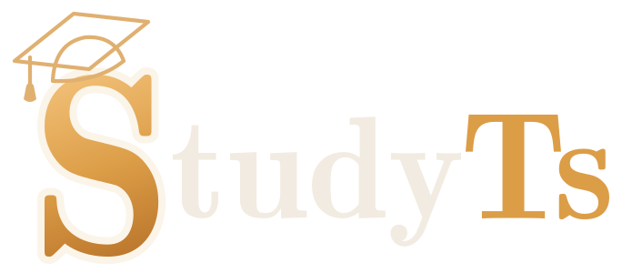
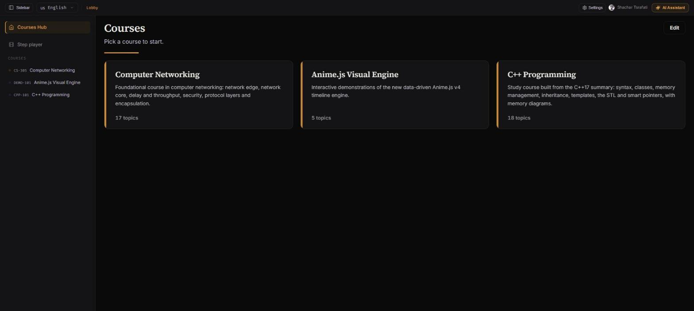
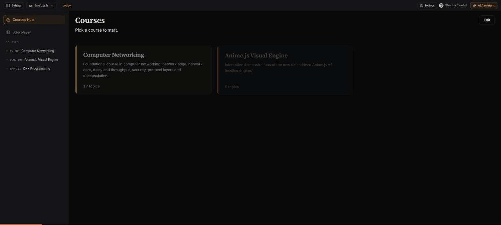
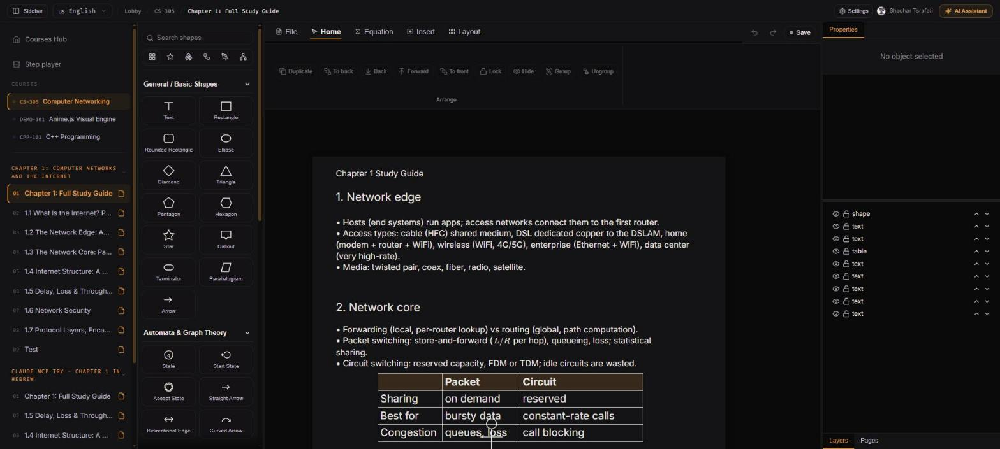
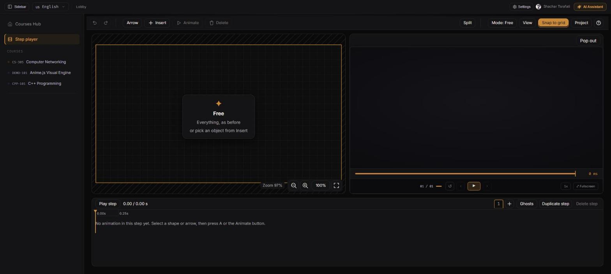

<div align="center">



**Local-first study platform for computer science: interactive canvases, step animations, and an AI assistant with MCP tools.**

[](https://nodejs.org)
[](https://www.typescriptlang.org)
[](https://react.dev)
[](https://www.prisma.io)
[](https://modelcontextprotocol.io)
[](LICENSE)

</div>

StudyTs runs on your machine. The UI is a React app served by a local Express server on `127.0.0.1`. Courses, notes, and the database stay in local files.



## Contents

- [Walkthrough](#walkthrough)
- [What you get](#what-you-get)
- [Quick start](#quick-start)
- [Using the app](#using-the-app)
- [AI assistant](#ai-assistant)
- [MCP server](#mcp-server)
- [Project layout](#project-layout)
- [Development](#development)
- [Troubleshooting](#troubleshooting)
- [License](#license)

## Walkthrough



| Canvas editor | Step player |
|:---:|:---:|
|  |  |
| Topic pages open in a vector canvas: shapes, arrows, text, tables, equations. | Step player: animate objects per step with timeline, ghosts, and playback speed. |

## What you get

- **Course hub**: courses are split into weeks and topics. Each topic opens as a canvas page.
- **Canvas editor**: shapes, arrows, text, tables, and KaTeX equations. Layers panel, snap guides, snap to grid, and PDF export.
- **Step player**: keyframe-style animation per step. Set position, opacity, and other properties over time, then scrub or play.
- **Course authoring**: create and edit courses in the app (**Edit** on the course hub).
- **AI assistant**: chat with an LLM that can read the open course and edit the canvas (see below).
- **MCP server**: a bundled stdio server exposes course, database, and notebook tools to any MCP client (see below).
- **Interface language**: English or Hebrew. The Hebrew UI runs right-to-left.
- **Local storage**: SQLite file in `prisma/`. Provider API keys are encrypted with AES-256-GCM in `server/secrets/` (`vault.enc`).

## Quick start

### Requirements

- Node.js **22.12 or newer** (the launcher installs LTS on Windows if missing)
- Git (to clone)

### Windows

Double-click `run.bat`, or run `studyts.cmd` from the project folder. The launcher checks Node, installs dependencies, sets up the database, builds the UI, starts the server, and opens the app.

### macOS / Linux

```bash
./studyts
```

### Any OS (npm)

```bash
git clone https://github.com/ShacharTs/StudyTs.git
cd StudyTs
npm install        # also generates the Prisma client
npm run setup      # applies migrations and seeds the database
npm start          # builds the UI if needed and opens the app
```

The app opens at **http://127.0.0.1:7301**. If that port is busy, the server uses the next free port in the range.

To stop: press `Ctrl+C` in the terminal, or run `npm run stop`.

## Using the app

1. **Pick a course** in the course hub. Expand a week to see its topics.
2. **Open a topic** to view its canvas. Select objects to edit them in the Properties panel.
3. **Open the step player** from the sidebar to build or play animations. Use the timeline to scrub.
4. **Export** a course as PDF from the course page (**Export course as PDF**).
5. **Switch language** with the language selector in the top bar.

### Keyboard

- `Ctrl/Cmd + Z`, `Ctrl/Cmd + Shift + Z`: undo / redo.
- `Ctrl/Cmd + A`: select all on the canvas.

> The public release ships without course content. The hub is empty until you create a course or copy course folders into `data/`.

## AI assistant

Open **AI Assistant** in the top bar. Add an API key in the AI settings (**Settings** in the top bar) first.

Supported providers (from `src/core/shared/aiProviders.ts`):

- Anthropic, OpenAI, Google Gemini, DeepSeek, xAI, Mistral, Groq, Cohere, Meta, Perplexity
- An optional local OmniRoute proxy (default port `20128`)

Keys are stored only on your machine, encrypted by the local server. They are never sent to StudyTs servers, because there are none.

The assistant can edit the open canvas through in-app scene operations (`apply_scene_ops`): insert and move objects, change text and formulas, and tidy layouts. These are applied as small steps, not full rewrites.

## MCP server

StudyTs bundles one stdio MCP server, `studyts-mcp` (`server/mcp/servers/studyTsServer.ts`). The app starts it automatically. Any MCP client can also start it directly.

Connect a client (run from the project root, because the server reads `./data`):

```json
{
  "mcpServers": {
    "studyts-mcp": {
      "command": "npx",
      "args": ["tsx", "server/mcp/servers/studyTsServer.ts"]
    }
  }
}
```

Tools, grouped by domain:

| Domain | Tool | What it does |
|---|---|---|
| Notebooks | `save_note_to_notebook` | Save a note or snippet to a notebook |
| | `search_notebook_notes` | Search saved notes |
| | `list_notebooks` | List notebooks and note counts |
| Course database | `show_database_tables` | List tables and columns |
| | `read_course_database` | Run a read-only `SELECT` (row-limited) |
| Authoring | `list_courses` | List courses, weeks, and lectures |
| | `list_lectures` | List lectures in a course |
| | `create_course` | Create a course |
| | `save_lecture_content` | Write lecture content |
| | `add_lecture_to_course_list` | Add a lecture to a course list |
| | `save_animated_lecture` | Save a step-animated lecture |
| | `add_network_diagram_to_lecture` | Add a network diagram to a lecture |

The database tool accepts only `SELECT`, `WITH`, and `PRAGMA table_info`.

## Project layout

```
src/                 React UI, canvas editor, step player, AI chat
server/              Express API, secrets vault, MCP servers
server/mcp/servers/  studyTsServer.ts (MCP entry point) and tool definitions
prisma/              Schema, migrations, seed, course loader
locales/             Localization dictionaries
asset/               Logos and screenshots
config/              runtimePorts.json (ports)
scripts/update/      In-app updater (checks GitHub Releases)
```

## Development

```bash
npm run dev         # Vite on :7300 with hot reload, API on :7301
npm run typecheck
npm run build
npm run prod:smoke  # boots the built app and checks the main routes
```

Developer checks (lint, tests, audits) live in the private development repository.

## Troubleshooting

- **Port in use**: the server picks the next free port. Check the terminal output for the URL.
- **Empty course hub**: no course data yet. Create a course with **Edit**.
- **AI says no provider**: add an API key in the AI settings (**Settings** in the top bar).
- **Database errors after a pull**: run `npm run setup` again to apply migrations.

## Support

If StudyTs helps your studying or teaching, you can support the project:

<a href="https://www.buymeacoffee.com/ShacharTs"></a>

## License

MIT. See [LICENSE](LICENSE).

Built with [React](https://react.dev), [Vite](https://vitejs.dev), [Prisma](https://www.prisma.io), [Express](https://expressjs.com), [Tiptap](https://tiptap.dev), [anime.js](https://animejs.com), [KaTeX](https://katex.org), [Framer Motion](https://www.framer.com/motion/), [Zustand](https://zustand.docs.pmnd.rs), [Lucide](https://lucide.dev), and [pdf.js](https://mozilla.github.io/pdf.js/).
